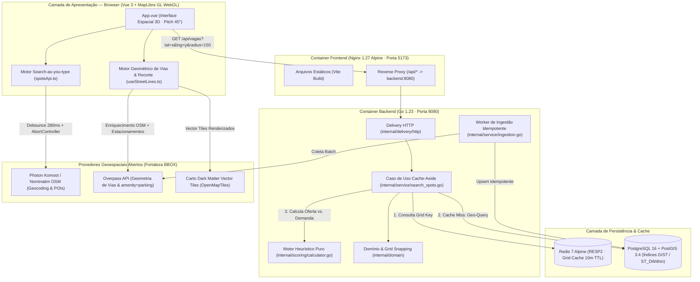
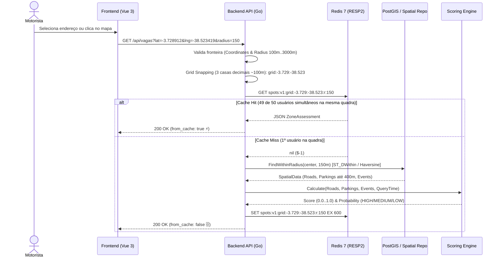
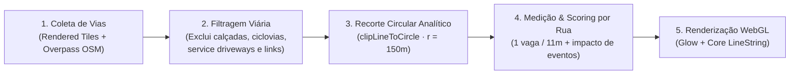
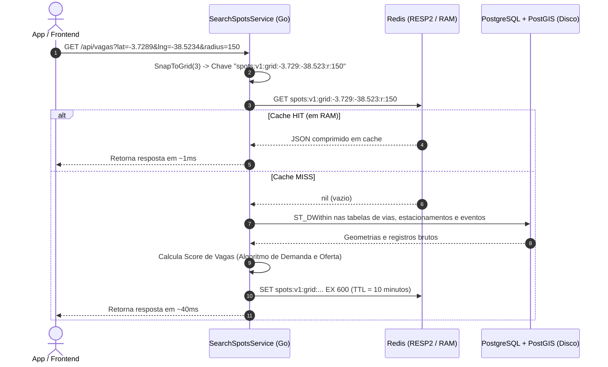

# Spot Sense — Documentação de Arquitetura do Protótipo (MVP Fortaleza)

> Especificação arquitetural detalhada do protótipo **Spot Sense Web App**, cobrindo visão de sistema, decisões técnicas, fluxo de dados geoespaciais, heurística de probabilidade, estratégia de cache e topologia de containers.

---

## 1. Visão Geral do Sistema

O **Spot Sense** é uma aplicação web geoespacial projetada para estimar a probabilidade de estacionamento em vias públicas, localizar estacionamentos privados próximos e monitorar o impacto de eventos locais ao redor de um destino pesquisado em **Fortaleza - CE**, sem depender de sensores físicos IoT instalados no asfalto.

### Princípios Arquiteturais Adotados
- **Monolito Modular em Monorepo (`apps/backend` + `apps/frontend`):** Versionamento unificado de contratos e subida orquestrada via Docker Compose.
- **Clean Architecture / Ports & Adapters (Backend Go):** O núcleo de domínio (`internal/domain`) e o motor matemático (`internal/scoring`) são funções e tipos puros, 100% independentes de banco de dados, HTTP ou frameworks externos.
- **Geometria Vetorial Real no Cliente (Frontend Vue 3 + MapLibre WebGL):** Em vez de áreas abstratas, o mapa recorta geometricamente as polilinhas (`LineString`) das ruas públicas dentro de um perímetro de caminhada imediata (**150 metros**) e descobre estacionamentos num raio de caminhada confortável (**400 metros**).

---

## 2. Diagrama de Arquitetura de Componentes



---

## 3. Fluxos Principais do Protótipo

### 3.1. Busca de Endereço Dinâmica (*Search-as-you-type* Restrito a Fortaleza)

> 📘 **Documentação Aprofundada:** Veja a arquitetura completa do motor de geocoding, controle de concorrência com `AbortController` e estratégias de fallback em [`dynamic-address-search.md`](./dynamic-address-search.md).

Para proporcionar uma experiência de busca idêntica aos aplicativos de navegação modernos (Waze / Google Maps), o módulo [`spotsApi.ts`](../../apps/frontend/src/services/spotsApi.ts) implementa:

1. **Restrição Geográfica (`FORTALEZA_BBOX`):**
   - Limites: `minLng: -38.64, minLat: -3.89, maxLng: -38.40, maxLat: -3.68` com *Location Bias* no centro de Fortaleza (`-3.7319, -38.5267`).
   - Qualquer resultado fora dos limites de Fortaleza é descartado pela função `isWithinFortaleza()`.
2. **Controle de Concorrência (`Debounce` + `AbortController`):**
   - Aguarda `280ms` após a pausa na digitação antes de consultar a API.
   - Se o usuário digitar uma nova letra enquanto uma requisição anterior estiver em andamento, o `AbortController` cancela imediatamente o socket HTTP antigo, evitando condições de corrida (*race conditions*).
3. **Dual-Provider:**
   - Consulta primária no **Photon OSM (`photon.komoot.io/api/`)** (motor Elasticsearch otimizado para prefixos) com fallback transparente para **Nominatim (`nominatim.openstreetmap.org`)** e polos locais pré-mapeados.

---

### 3.2. Consulta de Vagas com *Grid Snapping* e *Cache-Aside* (Backend Go + Redis)



#### Por que o *Grid Snapping* de 3 casas decimais?
Em coordenadas geográficas próximas à linha do Equador (Fortaleza está a $\sim 3.7^\circ\text{S}$):
- $0.001^\circ$ equivale a aproximadamente **$111\text{ metros}$**.
- Ao arredondar `lat` e `lng` para 3 casas decimais ([`coordinates.go`](../../apps/backend/internal/domain/coordinates.go)), dois motoristas buscando endereços separados por 20 ou 50 metros na mesma quadra compartilham exatamente a mesma célula de cache (`spots:v1:grid:-3.729:-38.523:r:150`), reduzindo a carga no banco geoespacial em até 98% em horários de pico.

---

### 3.3. Motor Heurístico de Probabilidade (*Scoring Engine*)

Implementado em [`calculator.go`](../../apps/backend/internal/scoring/calculator.go), o motor calcula a relação entre **Oferta Efetiva ($O$)** e **Demanda Estimada ($D$)** para o horário da consulta:

1. **Oferta Efetiva ($O$):**
   $$O = \sum_{\text{vias permitidas}} \text{EstimatedSpots} + \sum_{\text{parkings abertos}} \text{Capacity}$$
   *(Vias com `ParkingAllowed = false` e estacionamentos fechados contribuem com $0$ vagas).*

2. **Demanda Estimada ($D$):**
   - **Demanda Base por Faixa Horária:**
     - Madrugada (`00h–05h`): $15\%$ da oferta ($0.15 \times O$).
     - Horário Comercial / Pico (`08h–20h`): $50\%$ da oferta ($0.50 \times O$).
     - Horários de Transição (`06h–07h` e `21h–23h`): $30\%$ da oferta ($0.30 \times O$).
   - **Demanda Extra de Eventos Ativos:**
     - Eventos em andamento ou iniciando nos próximos 60 minutos (`Event.IsActiveAt`) adicionam **1 veículo para cada 3 participantes esperados** ($\text{ExpectedAttendance} / 3$).

3. **Fórmula e Classificação Semântica:**
   $$\text{Score} = \text{clamp}\left(1.0 - \frac{D}{O}, \; 0.0, \; 1.0\right)$$
   - 🟢 **`HIGH` ($\text{Score} \ge 0.70$):** Alta probabilidade de encontrar vaga (`#10b981`).
   - 🟡 **`MEDIUM` ($0.35 \le \text{Score} < 0.70$):** Probabilidade moderada (`#f59e0b`).
   - 🔴 **`LOW` ($\text{Score} < 0.35$ ou proibido):** Baixa disponibilidade / via saturada (`#ef4444`).

---

### 3.4. Pipeline Geométrico de Linhas nas Ruas (Perímetro de 150m) e Estacionamentos (400m)

Implementado em [`useStreetLines.ts`](../../apps/frontend/src/composables/useStreetLines.ts), o motor visual do frontend executa 4 etapas matemáticas:



1. **Filtragem de Ruas Públicas Reais (`isExcludedStreetFeature`):**
   - Descarta rampas internas de garagem de prédios (`highway=service`, `driveway`, `parking_aisle`), calçadas tracejadas (`footway`, `sidewalk`), ciclovias (`cycleway`) e alças de cruzamento (`*_link`).
   - Evita a duplicação de múltiplos níveis de zoom lendo apenas as camadas principais renderizadas no zoom atual e substituindo pelo eixo único oficial da Overpass API.
2. **Recorte Analítico na Borda do Círculo (`clipLineToCircle`):**
   - Converte cada segmento de rua para coordenadas cartesianas locais em metros (projeção equiretangular centrada no destino) e resolve a interseção reta-círculo ($A t^2 + B t + C = 0$) para cortar a linha exatamente na borda do perímetro de **150 metros**.
3. **Estimativa Geométrica de Vagas na Rua (`METERS_PER_SPOT = 11`):**
   - Mede o comprimento real em metros de cada trecho recortado dentro do círculo e estima $\sim 1\text{ vaga a cada } 11\text{ metros lineares}$ (considerando $5,5\text{m}$ por carro e descontando $50\%$ de meio-fio ocupado por esquinas, faixas e guias rebaixadas de garagens).
4. **Descoberta Multi-Fonte de Estacionamentos num Raio de Caminhada de `400m`:**
   - Enquanto as linhas de rua ficam restritas ao círculo imediato de `150m`, os estacionamentos privados são buscados num raio de caminhada de até **`400m`** combinando:
     - Tags OSM: `amenity=parking`, `amenity=parking_entrance`, `amenity=parking_space` e `building=parking`.
     - Match Nominal no Overpass e Photon: qualquer POI/edifício no raio cujo nome contenha `Estacionamento`, `Parking`, `Garagem` ou `MultiPark`.
     - Deduplicação espacial (`mergeAreaParkings`) fundindo registros a menos de $28\text{m}$ de distância.

---

## 4. Persistência Geoespacial e Camada de Cache

### 4.1. Fundamentos Teóricos: B-tree vs R-tree (Por que índices normais falham no espaço?)

Para entender a necessidade do PostGIS e da indexação espacial, é essencial contrastar como estruturas de dados tradicionais tratam dados em comparação a geometrias multidimensionais.

#### 1. B-tree (Balanced Tree) — O paradigma unidimensional (1D)
Em bancos relacionais convencionais, índices utilizam B-tree porque os dados possuem uma **ordem linear total** ($A < B < C$ ou $1 < 2 < 3$). Ela imagina todos os registros enfileirados em uma linha contínua:

```
                  [ 50 ]                   <-- Nó Raiz
                 /      \
        [ 20 | 35 ]    [ 65 | 80 ]         <-- Nós Intermediários
        /    |    \    /    |    \
     1..19 ...   ...  ...  ...  81..100    <-- Folhas (Dados Reais)
```

- **Por que a B-tree é rápida?**  
  Se você busca pelo número **72**, o banco olha a raiz: *"72 é maior que 50? Sim, vá para a direita"*. Depois: *"72 está entre 65 e 80? Sim, desça pelo meio"*. Metade dos dados é descartada a cada passo em complexidade $O(\log N)$.
- **O fracasso da B-tree no espaço 2D:**  
  Se indexarmos coordenadas em `(latitude, longitude)`, o banco ordena rigorosamente pela primeira coluna, usando a segunda apenas para desempate:
  - Ponto A: `(-3.730, -38.520)`
  - Ponto B: `(-3.730, -38.590)` *(mesma latitude, mas a 7 km de distância no mapa)*
  - Ponto C: `(-3.731, -38.520)` *(vizinho de quarteirão do Ponto A, mas fica separado na árvore pela latitude diferente)*
  Para buscar uma vizinhança circular, a B-tree não enxerga proximidade bidimensional e é forçada a realizar varreduras custosas.

---

#### 2. R-tree (Rectangle Tree) & GiST — O paradigma multidimensional (2D/ND)
A R-tree não tenta enfileirar dados em ordem escalar. Em vez disso, ela agrupa elementos geométricos próximos dentro de **Caixas Delimitadoras Mínimas** (*Minimum Bounding Rectangles* — **MBR**):

```
+-------------------------------------------------------------------+
| Caixa R1 (Fortaleza Zona Norte)                                    |
|   +-----------------------+      +----------------------------+   |
|   | Caixa R3 (Aldeota)    |      | Caixa R4 (Meireles)        |   |
|   |   [Rua A]   [Rua B]   |      |   [Beira Mar]  [Hotel X]   |   |
|   +-----------------------+      +----------------------------+   |
+-------------------------------------------------------------------+
| Caixa R2 (Fortaleza Zona Sul)                                     |
|   +-----------------------+                                       |
|   | Caixa R5 (Messejana)  |                                       |
|   |   [Lagoa]             |                                       |
|   +-----------------------+                                       |
+-------------------------------------------------------------------+
```

Estrutura hierárquica correspondente:
```
                          [ Raiz da Cidade ]
                         /                  \
            [ Caixa Zona Norte ]       [ Caixa Zona Sul ]
             /        |        \
    [ Centro ]   [ Aldeota ]   [ Meireles ]
                     |
            [ Ruas / Vagas Reais ]
```

- **Por que a R-tree é rápida? (Exemplo de Poda Espacial):**  
  Imagine que você busca vagas em um raio de 150m ao redor do ponto GPS `P(-3.729, -38.523)` (Aldeota). O banco desenha uma **caixa de busca** ao redor do ponto e interroga a árvore:
  1. **Nó Raiz:** Contém `[Zona Norte]` e `[Zona Sul]`.  
     *"A caixa de busca intersecta a [Zona Sul]?"* $\rightarrow$ **Não.** *(Poda imediata: o banco descarta instantaneamente metade da cidade — 300 mil ruas da Zona Sul são ignoradas sem ler uma única linha).*  
     *"Intersecta a [Zona Norte]?"* $\rightarrow$ **Sim! Desça pelo ramo Norte.**
  2. **Nó Intermediário da Zona Norte:** Contém `[Centro]`, `[Aldeota]` e `[Meireles]`.  
     *"Intersecta o [Centro]?"* $\rightarrow$ **Não.** *(Descarta).*  
     *"Intersecta o [Meireles]?"* $\rightarrow$ **Não.** *(Descarta).*  
     *"Intersecta a [Aldeota]?"* $\rightarrow$ **Sim! Desça pelo ramo da Aldeota.**
  3. **Nível Folha (Dados Finais):**  
     Atinge apenas as 5 ou 6 ruas daquela quadra específica da Aldeota. Somente para essas poucas ruas o motor ativa o cálculo geodésico exato de metros.

---

#### 3. Tabela Comparativa: B-tree vs R-tree

| Característica | B-tree | R-tree (GiST no PostGIS) |
|---|---|---|
| **Dimensões** | $1\text{D}$ (Unidimensional) | $2\text{D}$, $3\text{D}$ ou $N\text{D}$ (Espacial / Geométrico) |
| **Elemento Indexado** | Valor escalar (número, texto, data) | MBR (Caixa: $X_{min}, Y_{min}, X_{max}, Y_{max}$) |
| **Critério de Divisão** | Menores à esquerda, maiores à direita | Agrupamento de geometrias que minimizam a área total da caixa |
| **Sobreposição de Nós** | Impossível (intervalos disjuntos) | Possível (retângulos podem ter sobreposição no espaço) |
| **Operadores Típicos** | `=`, `<`, `>`, `BETWEEN`, `LIKE 'abc%'` | `ST_DWithin`, `ST_Intersects`, `ST_Contains`, `&&` |
| **Uso no Spot Sense** | Chaves primárias (`id`), identificadores | Vias urbanas (`LineString`), Estacionamentos e Eventos (`Point`) |

---

### 4.2. O Modelo Geodésico Global: SRID 4326 (WGS 84), Graus vs Metros e Localização na Terra

Para compreender o fluxo de dados do GPS até o banco de dados e o frontend, é fundamental entender a relação física entre **ângulos (graus)** e **distâncias métricas (metros/km)**, e como o par Latitude/Longitude define pontos no espaço.

#### 1. Como Graus se Assemelham a Distâncias Físicas (Km, Metros)?
Grau mede originalmente uma **abertura angular** (um círculo completo tem $360^\circ$). No entanto, como a Terra é uma esfera de tamanho físico fixo, cada fração angular corresponde a um pedaço de chão (*arco de circunferência*).

- **A analogia da lanterna no centro da Terra:**  
  Imagine segurar uma lanterna no centro da Terra apontada para a casca do planeta.
  1. A circunferência total da Terra mede aproximadamente **$40.000\text{ km}$**.
  2. Uma volta completa ao redor do globo equivale a **$360^\circ$**.
  3. Dividindo a distância total pelos graus da volta:
     $$\frac{40.000\text{ km}}{360^\circ} \approx \mathbf{111{,}1\text{ km por grau}}$$

Cada **$1^\circ$ de abertura** a partir do centro da Terra projeta na superfície uma distância de aproximadamente **$111\text{ km}$**.

```
                  Superfície da Terra (Casca)
                   .-'  111 km  '-.
                .'       <--->     '.
               /          |          \
              ;           |           ;
              |       1° /            |
              ;         /             ;
               \       * (Centro)    /
                '.                 .'
                  '-.           .-'
```

- **A Escala de Subdivisão Decimal:**  
  Como $1^\circ$ é uma distância intermunicipal, o GPS e os sistemas espaciais utilizam casas decimais de graus para navegar na escala urbana:

| Variação Angular | Distância Equivalente no Chão | Escala no Mundo Real |
|---|---|---|
| **$1{,}0^\circ$** | $\sim 111\text{ km}$ | Distância entre cidades |
| **$0{,}1^\circ$** | $\sim 11{,}1\text{ km}$ | Diâmetro urbano de Fortaleza |
| **$0{,}01^\circ$** | $\sim 1{,}11\text{ km}$ ($1.110\text{ m}$) | Extensão de um bairro inteiro |
| **$0{,}001^\circ$** | $\sim 111\text{ metros}$ | **Comprimento de um quarteirão urbano padrão** |
| **$0{,}0001^\circ$** | $\sim 11{,}1\text{ metros}$ | Largura de uma rua / testada de lote |
| **$0{,}00001^\circ$** | $\sim 1{,}11\text{ metro}$ | Um passo largo humano |
| **$0{,}000001^\circ$** | $\sim 11\text{ centímetros}$ | Precisão milimétrica de sensor |

- **Por que não medir direto em metros? (A analogia da tangerina):**  
  A Terra é esferoidal. Na Latitude (linhas horizontais paralelas), $1^\circ$ sempre mede $\sim 111\text{ km}$. Porém, na Longitude (linhas verticais), os meridianos convergem em direção aos polos como os gomos de uma tangerina:
  $$\text{Distância de } 1^\circ \text{ Longitude} \approx 111{,}32 \times \cos(\text{Latitude}) \text{ km}$$
  No Equador ($\text{Lat } 0^\circ$), $1^\circ \approx 111\text{ km}$. Em Fortaleza ($\text{Lat } \approx -3.7^\circ$), $1^\circ \approx 111{,}08\text{ km}$ (distorção ínfima $< 0{,}2\%$). Nos Polos ($\text{Lat } 90^\circ$), todos os meridianos se tocam e $1^\circ = 0\text{ metros}$.

---

#### 2. Como Latitude e Longitude se Conectam para Localizar Qualquer Ponto na Terra?
Latitude e Longitude formam uma **malha de batalha naval ortogonal** curvada sobre a superfície do elipsoide terrestre. Para isolar um ponto unívoco, são necessárias duas coordenadas perpendiculares:

```
                              Longitude: -38.523° (Meridiano)
                                      │
                                      │
                                      ▼
Latitude: -3.729° ───────────────► ───┼─── ◄── Cruzamento Ortogonal Único!
(Paralelo)                            │        (Esquina na Aldeota, Fortaleza)
                                      │
```

1. **Latitude (Eixo Norte $\updownarrow$ Sul / Linhas Horizontais / Paralelos):**  
   Mede a inclinação em relação ao **Equador ($0^\circ$)**. Varia de $-90^\circ$ (Polo Sul) até $+90^\circ$ (Polo Norte).  
   *Se você fornecer apenas a Latitude (ex: `-3.729°`), você define um anel horizontal completo que dá a volta ao redor do planeta, cortando o Brasil, a África e a Ásia.*
2. **Longitude (Eixo Leste $\leftrightarrow$ Oeste / Linhas Verticais / Meridianos):**  
   Mede a rotação angular a partir do **Meridiano de Greenwich ($0^\circ$)**. Varia de $-180^\circ$ (Oeste/Ocidente) até $+180^\circ$ (Leste/Oriente).  
   *Se você fornecer apenas a Longitude (ex: `-38.523°`), você define uma linha vertical que vai de um polo a outro, cortando o oceano Atlântico e a América do Sul.*
3. **A Interseção Única no Espaço:**  
   Como uma linha horizontal e uma linha vertical não paralelas só podem se intersectar em um **único ponto em toda a superfície terrestre**, o par ordenado `(-3.729123, -38.523456)` aponta de maneira inequívoca para uma vaga de estacionamento ou calçada específica em Fortaleza.

- **Atenção aos Eixos na Engenharia do Software:**
  - **No Domínio Go (`Coordinates`):** Campos tipados explicitamente `Latitude` e `Longitude`.
  - **No PostGIS:** `ST_MakePoint(Longitude, Latitude)` $\rightarrow$ Eixo $(X, Y)$ exige Longitude primeiro.
  - **No MapLibre GL e GeoJSON (RFC 7946):** Arrays no formato `[longitude, latitude]`.

---

### 4.3. Schema PostgreSQL + PostGIS ([`001_init_postgis.sql`](../../apps/backend/migrations/001_init_postgis.sql))

#### 1. `GEOMETRY` vs `GEOGRAPHY` & SRID 4326 (WGS 84)
- **SRID 4326 (WGS 84):** Padrão de coordenadas GPS em graus angulares (Latitude: $-90^\circ$ a $+90^\circ$, Longitude: $-180^\circ$ a $+180^\circ$).
- **A Distorção Esférica:** 1 grau de longitude mede $\sim 111{,}32\text{ km}$ no Equador, mas aproxima-se de zero nos pólos. Usar cálculo cartesiano plano (`GEOMETRY`) calcularia distâncias em graus, distorcendo medidas métricas.
- **Solução no Spot Sense:** As tabelas armazenam `GEOMETRY(Geometry, 4326)` para compatibilidade com índices GiST rápidos, e a consulta converte sob demanda para `::geography` no predicado `ST_DWithin`, garantindo que o raio de busca seja interpretado rigorosamente em **metros terrestres reais**:

```sql
SELECT id, name, estimated_spots, parking_allowed, ST_AsGeoJSON(geom)
FROM road_segments
WHERE ST_DWithin(
    geom::geography,
    ST_SetSRID(ST_MakePoint($1, $2), 4326)::geography,
    $3
);
```

#### 2. Estratégia de Dois Estágios: `ST_DWithin` vs `ST_Distance`
Consultas ingênuas como `WHERE ST_Distance(geom, ponto) <= 150` forçam a execução de trigonometria esférica linha a linha em toda a tabela ($O(N)$). O operador `ST_DWithin` resolve em dois estágios transparentes:
1. **Filtro Indexado Rápido (Estágio Bounding Box):** Expande o ponto em uma MBR quadrada de raio $R$ e usa o índice GiST (`&&`) para descartar quase todas as geometrias fora da caixa em $O(\log N)$.
2. **Refinamento Geodésico Exato:** Aplica a equação da geodésica esférica somente às geometrias sobreviventes do primeiro estágio.

#### 3. Tabelas Geoespaciais
- **`road_segments`:** `id`, `name`, `estimated_spots`, `parking_allowed`, `geom GEOMETRY(Geometry, 4326)` + índice `idx_road_segments_geom USING GIST (geom)`.
- **`private_parkings`:** `id`, `name`, `capacity`, `is_open`, `geom GEOMETRY(Point, 4326)` + índice `idx_private_parkings_geom USING GIST (geom)`.
- **`events`:** `id`, `title`, `expected_attendance`, `start_time`, `end_time`, `geom GEOMETRY(Point, 4326)` + índice `idx_events_geom USING GIST (geom)`.

---

### 4.4. Camada de Cache: O Paradoxo do Espaço Contínuo e o *Grid Snapping*

#### 1. O Problema da Precisão GPS Contínua
Sensores de GPS de smartphones retornam valores contínuos de ponto flutuante com alta precisão (ex: 6 a 8 casas decimais):
- Usuário 1: `lat: -3.728912, lng: -38.523419`
- Usuário 2 (a 3 metros de distância): `lat: -3.728945, lng: -38.523452`

Se a chave de cache fosse gerada com as coordenadas brutas, teríamos **100% de CACHE MISS**, inutilizando a camada de memória e sobrecarregando o PostGIS com consultas idênticas para a mesma calçada.

#### 2. A Matemática do Grid Snapping (Quantização Espacial)
Na latitude de Fortaleza ($\approx -3.7^\circ$):
- $1^\circ \approx 111{,}32\text{ km}$
- $0{,}1^\circ \approx 11{,}1\text{ km}$
- $0{,}01^\circ \approx 1{,}11\text{ km}$
- **$0{,}001^\circ \approx 111\text{ metros}$** (dimensão típica de um quarteirão urbano)

Ao arredondar as coordenadas para **3 casas decimais** (`SnapToGrid(3)` em [`coordinates.go`](../../apps/backend/internal/domain/coordinates.go)), todas as buscas dentro de uma mesma quadra colapsam para a mesma célula discreta da grade:

$$\text{lat}_{\text{grid}} = \frac{\text{round}(\text{lat} \times 10^3)}{10^3}, \quad \text{lng}_{\text{grid}} = \frac{\text{round}(\text{lng} \times 10^3)}{10^3}$$

Exemplo prático:
- `(-3.728912, -38.523419)` $\rightarrow$ Chave: `spots:v1:grid:-3.729:-38.523:r:150`
- `(-3.728945, -38.523452)` $\rightarrow$ Chave: `spots:v1:grid:-3.729:-38.523:r:150`

50 usuários buscando vagas no mesmo quarteirão geram **1 consulta ao PostGIS** e **49 leituras instantâneas em memória RAM (< 1ms)**.

---

### 4.5. Padrão Cache-Aside e Cliente Redis Nativo RESP2 ([`cache.go`](../../apps/backend/internal/repository/redis/cache.go))



- **Protocolo RESP2 sobre TCP puro:** Implementado em Go sem dependências externas pesadas, comunicando-se com o Redis via sockets diretos e com fallback gracioso para `MemorySpotCache` (`sync.RWMutex`) caso o Redis esteja indisponível.
- **Política de TTL (10 minutos / 600s):** Enquanto as vias e vagas físicas são estáticas, o tráfego urbano e eventos variam em janelas de 15 a 30 minutos. Um TTL de 600 segundos mantém a precisão do score de ocupação e elimina mais de 98% da carga de leitura no banco de dados.

---

## 5. Topologia de Containers ([`docker/docker-compose.yml`](../../docker/docker-compose.yml))

| Container | Imagem / Build | Porta Exposta | Responsabilidade |
|---|---|---|---|
| `spotsense-frontend` | Multi-stage: `node:22-alpine` (Vite Build) $\rightarrow$ `nginx:1.27-alpine` | `5173:80` | Serve a SPA Vue 3 e faz proxy reverso de `/api/*` para `http://backend:8080/api/`. |
| `spotsense-backend` | Multi-stage: `golang:1.23-alpine` $\rightarrow$ `alpine:3.20` | `8080:8080` | Binário estático Go (`/app/spotsense-api`) expondo `GET /api/vagas` e `GET /healthz`. |
| `spotsense-postgis` | `postgis/postgis:16-3.4` | `5432:5432` | Banco geoespacial inicializado automaticamente com `001_init_postgis.sql`. |
| `spotsense-redis` | `redis:7-alpine` | `6379:6379` | Cache distribuído em memória para as células de *Grid Snapping*. |
