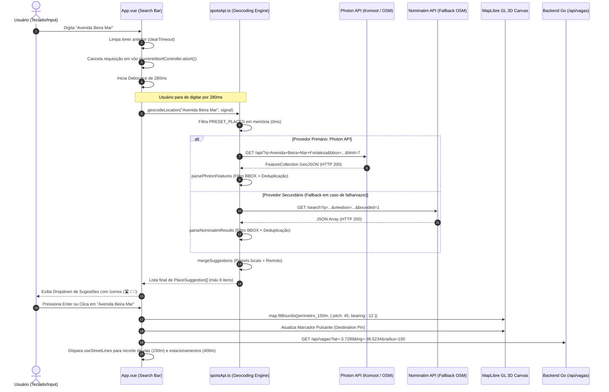
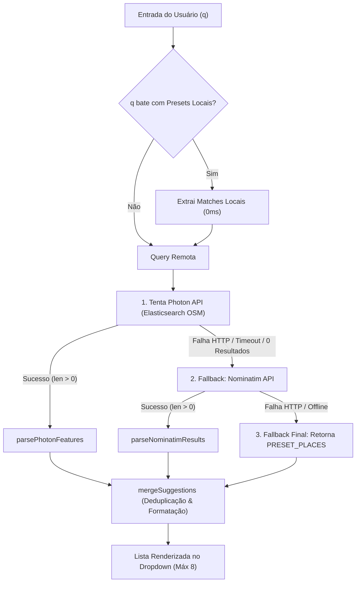

# Arquitetura da Busca Dinâmica de Endereços (Geocoding & Autocomplete)

Este documento detalha a arquitetura, as decisões de engenharia e os mecanismos de resiliência implementados no motor de **busca dinâmica de endereços** (*Search-as-you-type* / *Autocomplete*) do **Spot Sense**.

---

## 1. Visão Geral e Objetivos de Engenharia

O motor de busca de endereços é a porta de entrada da experiência do usuário no Spot Sense. A arquitetura foi desenhada para atender aos seguintes requisitos fundamentais:

1. **Geofencing Estrito em Fortaleza - CE:** Impedir que o usuário receba ou selecione resultados de outros municípios ou estados (ex: buscar "Beira Mar" não deve retornar Florianópolis ou Fortaleza de Minas).
2. **Latência Percebida Mínima (< 300ms):** Resposta ágil conforme o usuário digita, combinando presets locais em memória e APIs públicas otimizadas.
3. **Resiliência a Falhas de Rede Externa:** Mecanismo de contingência (*Dual-Provider Fallback*) entre a API Photon (Komoot) e a API Nominatim (OpenStreetMap).
4. **Prevenção de Race Conditions:** Garantir que requisições mais lentas em trânsito não sobrescrevam resultados mais recentes digitados pelo usuário.
5. **Acessibilidade e Navegação por Teclado:** Controle fluido via teclado (`↑`, `↓`, `Enter`, `Escape`) além do clique em tela.

---

## 2. Diagrama de Sequência End-to-End

O fluxo completo desde a digitação da primeira tecla até a renderização das vagas no mapa:



---

## 3. Componentes e Estratégias Arquiteturais

### 3.1. Prevenção de Race Conditions com `AbortController`
Em interfaces reativas de autocomplete, conexões assíncronas concorrentes criam o clássico **problema de inversão temporal**:
- O usuário digita `"Aven"` $\rightarrow$ Dispara Requisição 1 (demora 500ms por oscilação de rota).
- O usuário digita rapidamente `"Avenida Beira"` $\rightarrow$ Dispara Requisição 2 (demora 150ms).
- A Requisição 2 responde primeiro e renderiza "Avenida Beira Mar".
- 350ms depois, a Requisição 1 finalmente chega e **sobrescreve a tela com os resultados velhos de "Aven"**.

**Implementação no Spot Sense ([`App.vue`](../../apps/frontend/src/App.vue)):**
```typescript
let currentAbortController: AbortController | null = null

function handleSearchInput() {
  // 1. Cancela a requisição HTTP em trânsito no navegador imediatamente
  if (currentAbortController) {
    currentAbortController.abort()
  }

  // 2. Cria um novo controller para a consulta atual
  debounceTimer = setTimeout(async () => {
    currentAbortController = new AbortController()
    try {
      const results = await geocodeLocation(q, currentAbortController.signal)
      suggestions.value = results
    } catch (err: any) {
      if (err?.name !== 'AbortError') {
        suggestions.value = PRESET_PLACES
      }
    }
  }, 280)
}
```

---

### 3.2. Debounce Calibrado (280ms)
- **Por que não 100ms?** Gera chamadas desnecessárias a cada tecla digitada, degradando a performance do cliente e arriscando bloqueio por rate limit nas APIs públicas.
- **Por que não 500ms?** Cria uma sensação perceptível de lentidão ou congelamento da interface ("lag").
- **O equilíbrio de 280ms:** Intervalo médio da pausa natural entre palavras de um usuário digitando em celulares ou computadores.

---

### 3.3. Geofencing Estrito: Bounding Box e Filtro Residual

Para travar todas as buscas estritamente dentro da cidade de Fortaleza - CE, a aplicação utiliza três camadas de isolamento:

#### 1. Coordenadas da Bounding Box de Fortaleza ([`spotsApi.ts`](../../apps/frontend/src/services/spotsApi.ts))
$$\text{Oeste (Min Lng)}: -38{,}64^\circ \quad \text{Leste (Max Lng)}: -38{,}40^\circ$$
$$\text{Sul (Min Lat)}: -3{,}89^\circ \quad \text{Norte (Max Lat)}: -3{,}68^\circ$$

#### 2. Parâmetros nas Requisições Externas:
- **Photon API:** `&lat=-3.7319&lon=-38.5267&bbox=-38.64,-3.89,-38.40,-3.68` (Aplica viés de proximidade radial e delimitação em caixa).
- **Nominatim:** `&viewbox=-38.64,-3.68,-38.40,-3.89&bounded=1&countrycodes=br` (Força rejeição de nós fora do polígono).

#### 3. Guarda de Validação Residual em Código (`isWithinFortaleza`):
Mesmo que um provedor externo retorne acidentalmente uma cidade homônima fora do Ceará, a função descarta o item antes da renderização:
```typescript
export function isWithinFortaleza(coords: CoordinatesDTO): boolean {
  return (
    coords.lat >= FORTALEZA_BBOX.minLat &&
    coords.lat <= FORTALEZA_BBOX.maxLat &&
    coords.lng >= FORTALEZA_BBOX.minLng &&
    coords.lng <= FORTALEZA_BBOX.maxLng
  )
}
```

---

### 3.4. Dual-Provider Fallback (Photon + Nominatim)

Nenhum serviço gratuito externo possui 100% de disponibilidade. A camada [`spotsApi.ts`](../../apps/frontend/src/services/spotsApi.ts) implementa um pipeline de redundância:



| Provedor | Motor | Vantagens | Papel no Spot Sense |
|---|---|---|---|
| **Photon (Komoot)** | Elasticsearch sobre OSM | Respostas sub-100ms, otimizado para *Search-as-you-type* e typos. | **Provedor Primário** |
| **Nominatim** | Motor PostgreSQL/PostGIS oficial OSM | Estrutura de endereçamento detalhada com número de porta e bairro. | **Fallback Secundário** |
| **Presets Locais** | Array em memória RAM | Latência zero (0ms), opera 100% offline. | **Camada Base / Fallback Final** |

---

### 3.5. Deduplicação e Categorização Semântica

O OpenStreetMap frequentemente armazena vias urbanas como múltiplos nós e segmentos com identificadores OSM distintos. Sem tratamento, uma busca por "Rua Canuto de Aguiar" mostraria 4 vezes a mesma rua no dropdown.

#### Algoritmo de Deduplicação:
Gera uma chave determinística baseada na junção de `nome` e `bairro`:
```typescript
const dedupKey = `${primaryName.toLowerCase()}|${district.toLowerCase()}`
if (seen.has(dedupKey)) continue
seen.add(dedupKey)
```

#### Classificação Visual no Dropdown:
- 🛣️ **`street`:** Rodovias, avenidas, ruas e travessas (`highway`, `type=street`).
- 📍 **`venue`:** Shoppings, praças, polos culturais, estádios e pontos de interesse comercial.
- 🏙️ **`district`:** Bairros e localidades inteiras (`suburb`, `locality`).

---

### 3.6. Presets Locais Instantâneos (`PRESET_PLACES`)

Para garantir que o usuário tenha opções de clique imediato sem precisar digitar nada (e como rede de segurança para demonstrações offline), foram catalogados 8 polos de alto fluxo em Fortaleza:

1. **Avenida Beira Mar (Feirinha / Meireles):** `-3.728912, -38.523419`
2. **Praça Portugal & Av. Desembargador Moreira (Aldeota):** `-3.7336, -38.4979`
3. **Shopping Iguatemi Bosque (Edson Queiroz):** `-3.7564, -38.4896`
4. **Centro Dragão do Mar de Arte e Cultura (Praia de Iracema):** `-3.7219, -38.5215`
5. **RioMar Fortaleza (Papicu):** `-3.7408, -38.4712`
6. **Arena Castelão (Boa Vista):** `-3.8073, -38.5225`
7. **Orla do Mucuripe & Mercado dos Peixes:** `-3.7258, -38.4982`
8. **Avenida Monsenhor Tabosa (Praia de Iracema):** `-3.7265, -38.5180`

---

## 4. Integração com a Câmera 3D do MapLibre GL

Quando um endereço é selecionado via clique, sugestão ou pressionando `Enter`:

```typescript
function selectPlace(place: PlaceSuggestion) {
  selectedPlace.value = place
  searchQuery.value = place.name
  showSuggestions.value = false

  // 1. Move a câmera preservando a perspectiva inclinada Waze 3D
  mapInstance.fitBounds(
    [
      [place.coordinates.lng - 0.002, place.coordinates.lat - 0.002],
      [place.coordinates.lng + 0.002, place.coordinates.lat + 0.002],
    ],
    {
      padding: { top: 60, bottom: 60, left: 60, right: 60 },
      pitch: 45,      // Inclinação 3D
      bearing: -12,   // Orientação da via
      duration: 1200, // Animação suave
    }
  )

  // 2. Dispara o ciclo de avaliação de vagas e extração de ruas
  fetchAssessment(place.coordinates.lat, place.coordinates.lng)
}
```

Além disso, o mapa possui a trava de segurança `maxBounds`:
```typescript
maxBounds: [
  [FORTALEZA_BBOX.minLng, FORTALEZA_BBOX.minLat],
  [FORTALEZA_BBOX.maxLng, FORTALEZA_BBOX.maxLat]
]
```
Isso impede que o usuário arraste ou desloque a câmera acidentalmente para fora da área metropolitana de Fortaleza.

---

## 5. Testes Automatizados e Confiabilidade

O comportamento deste motor é verificado continuamente por testes automatizados em [`apps/frontend/tests/run-tests.ts`](../../apps/frontend/tests/run-tests.ts):

- `isWithinFortaleza`: Valida inclusão de pontos em Fortaleza (ex: Centro, Aldeota) e rejeição estrita de pontos em Caucaia, Maracanaú, São Paulo e Rio de Janeiro.
- `buildPhotonAutocompleteUrl` & `buildNominatimAutocompleteUrl`: Valida a formatação correta de strings de query e bounding boxes geodésicas.
- `parsePhotonFeatures`: Valida extração de GeoJSON, descarte de geometrias corrompidas e preenchimento de subtítulo e categoria.
- `mergeSuggestions`: Valida o teto de 8 resultados e a ausência de duplicatas nominais.

---

## 6. Resumo das Interfaces TypeScript

```typescript
export type PlaceCategory = 'street' | 'venue' | 'district'

export interface PlaceSuggestion {
  id: string
  name: string
  subtitle: string
  category?: PlaceCategory
  coordinates: CoordinatesDTO
}

export interface CoordinatesDTO {
  lat: number
  lng: number
}
```
