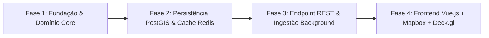

# Spot Sense — Development Plan

> Planejamento das fases, marcos e entregas de desenvolvimento do projeto Spot Sense.

---

## Visão Geral das Fases

---

## Detalhamento das Fases

### Fase 1: Fundação & Domínio Core (TDD)
- **Marco 1.1:** Setup inicial do repositório (Monorepo Go + Vue 3).
- **Marco 1.2:** Modelagem das entidades puras do domínio (`Location`, `Spot`, `RoadSegment`, `PrivateParking`, `Event`).
- **Marco 1.3:** Implementação com TDD do algoritmo de **Grid Snapping** (~100m / 3 casas decimais).
- **Marco 1.4:** Implementação com TDD do motor heurístico de **Scoring** (ponderação de oferta vs demanda).

### Fase 2: Persistência PostGIS & Cache Redis
- **Marco 2.1:** Configuração do ambiente de banco com PostGIS via Docker Compose.
- **Marco 2.2:** Criação de schemas e índices espaciais `GIST` nas colunas de geometria.
- **Marco 2.3:** Implementação e teste de integração do repositório PostGIS com `ST_DWithin` (raio de 1 km).
- **Marco 2.4:** Implementação do repositório de Cache no Redis com chave normalizada por Grid Snapping e expiração por TTL.

### Fase 3: Backend REST API & Ingestão em Background
- **Marco 3.1:** Implementação do endpoint central `GET /api/vagas?lat={x}&lng={y}&radius=1000` via Chi.
- **Marco 3.2:** Integração do fluxo completo (Requisição -> Cache Hit/Miss -> Geo-Query -> Scoring -> Resposta JSON).
- **Marco 3.3:** Implementação do Worker de Ingestão de vias e estacionamentos públicos (OpenStreetMap / Overpass API).
- **Marco 3.4:** Implementação do Worker de Ingestão de Eventos regionais (Sympla API).

### Fase 4: Frontend Interativo (Vue 3 + Mapbox + Deck.gl)
- **Marco 4.1:** Setup do cliente Vue 3 com Vite e TailwindCSS.
- **Marco 4.2:** Integração com Mapbox GL JS (renderização do mapa e navegação).
- **Marco 4.3:** Barra de busca com autocomplete consumindo a Mapbox Geocoding API.
- **Marco 4.4:** Camada visual de hexágonos Deck.gl (HexagonLayer) para visualização de zonas de prováveis vagas e marcação de estacionamentos/eventos.
